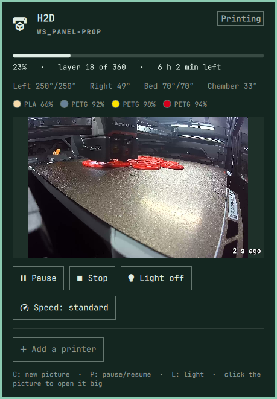
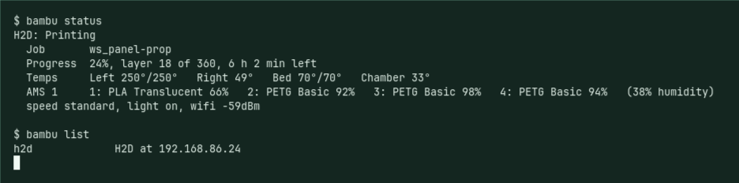
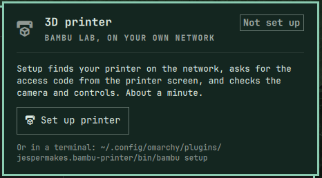
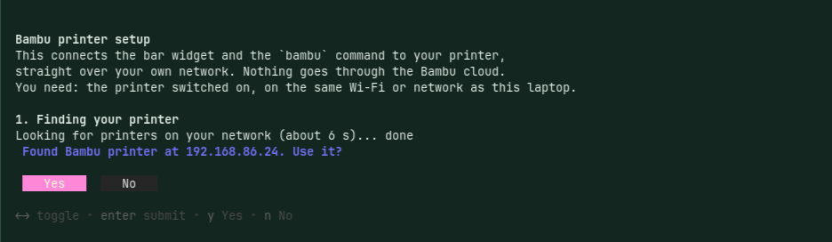

# Bambu printer for Omarchy

Your Bambu Lab 3D printers in the [Omarchy](https://omarchy.org) bar: progress, temperatures,
spools, the chamber camera, notifications, and pause, stop, light and speed. It talks straight to
the printer over your own network, so it works without the Bambu cloud, without an account, and
without installing anything else.

<p align="center">
  
</p>

```
omarchy plugin add https://github.com/jespermakes/omarchy-bambu.git --enable
```

Then click the printer icon in the bar and press **Set up printer**.

## What you get

- **The bar icon** turns yellow while printing, green when a print is done and waiting on the
  bed, and red when it paused, failed or reports an error. Hover for progress and time left.
- **The panel** shows the chamber camera, nozzle, bed and chamber temperatures, the AMS spools
  with their real colours and how much is left on each, and buttons for pause, resume, stop
  (it asks twice), chamber light and print speed.
- **Notifications** when a print finishes, fails or pauses.
- **Several printers.** One icon for all of them, showing the one that needs you most, and a
  switcher in the panel.
- **A `bambu` command** for the terminal, for scripts, and for AI agents:

<p align="center">
  
</p>

```
bambu setup                  add a printer (or set one up again), step by step
bambu list                   the printers you have set up
bambu status [--json]        what they are doing now
bambu watch [--json]         follow them live
bambu pause | resume
bambu stop [--yes]           cancel the print (asks first)
bambu light on|off
bambu speed silent|standard|sport|ludicrous
bambu snapshot [FILE]        one camera picture
bambu doctor                 check every part of the connection
bambu rename PRINTER NAME
bambu forget PRINTER
```

## Setup

The first time, the panel offers one button:

<p align="center">
  
</p>

Setup runs in a terminal and takes about a minute:

<p align="center">
  
</p>

1. **It finds the printer.** It scans your local network for Bambu printers, whose certificate
   carries the serial number, and also listens for the announcements printers send. Omarchy's
   firewall blocks those announcements by default, so the scan is what usually finds it. You
   can type the address instead.
2. **It asks for the access code**, 8 characters, and tells you where it is on the printer
   screen. It is the printer's password on your network.
3. **It tests the connection, the controls and the camera**, and explains anything that is off.
4. **It asks what you call the printer** and saves everything to
   `~/.config/bambu-printer/printers.json`, readable only by you.
5. **It offers to make `bambu` a command** you can type anywhere (`~/.local/bin/bambu`).

## More than one printer

Run setup again, or press **Add a printer** in the panel, for each one. The name you give a
printer is how you pick it:

```
bambu pause garage
bambu light off -p h2d
```

`status`, `watch` and `doctor` cover every printer when you name none. The bar icon shows the
printer that needs you most (red beats yellow beats green), the tooltip lists them all, and the
panel has a switcher at the top (keys 1 to 9).

## Developer Mode: read this before you turn it on

**Reading** the printer (status, camera, spools, notifications) works with the printer's normal
settings. **Controls** (pause, resume, stop, light, speed) need two switches on the printer:
*LAN Only Mode*, then *Developer Mode*. Since Bambu's 2025 firmware the printer refuses commands
from other apps without them. Setup checks which mode your printer is in and says so, and the
panel explains it again if you try.

The cost: in LAN Only Mode the Bambu Handy app and cloud printing stop working. You print from
Bambu Studio or Orca Slicer on the same network instead. If you rely on the phone app, leave it
off. The plugin is still useful read-only.

## Tested on

| Printer | Status | Controls | Camera |
|---|---|---|---|
| H2D, firmware 01.04.00.00, LAN Only + Developer Mode | tested | light tested; pause and stop not yet | tested (ffmpeg 6 and 9) |
| X1 / X1C / X1E | should work, same protocol | should work | should work, same camera |
| P1P / P1S / A1 / A1 mini | should work | should work | **untested**: a different camera protocol |
| any model with Developer Mode off | **untested**: should read fine | refused, as designed | should work |

Tested on Omarchy 4.5 on a 2019 Lenovo Yoga. Several printers tested with one real printer and
one that does not answer. Reports from other printers are very welcome:
[open an issue](https://github.com/jespermakes/omarchy-bambu/issues/new?template=printer-report.md)
with the output of `bambu doctor`. It never prints your access code.

## When it does not work

| What you see | Why | What to do |
|---|---|---|
| Setup finds no printer | The laptop is on another network (guest Wi-Fi, a VPN), or the network is bigger than 254 addresses | Same network, VPN off, or type the printer's IP |
| Nothing connects at all, even by IP | The router keeps Wi-Fi devices apart ("client isolation" or "AP isolation", common on guest and mesh networks) | Turn isolation off for your home network in the router |
| "refused the access code" | The code changed (it can be refreshed on the printer) | `bambu setup`, pick the printer, set it up again |
| Pause, stop or light refused | Developer Mode is off | See above, or keep it read-only |
| "No camera picture" | *LAN Only Liveview* is off on the printer | Turn it on in the printer's network settings |
| The camera fails on a P1 or A1 | That camera code is untested | `bambu doctor`, and open an issue |
| Worked yesterday, offline today | The router gave the printer a new address | It finds the same printer by serial and follows it (`bambu doctor` forces it). A fixed address in the router stops it for good |
| Worked before a firmware update, not after | Bambu changes what other apps may do (they did in 2025) | Open an issue with the `bambu doctor` output |

## Fixing it yourself, or with an AI agent

The whole thing is two readable files with nothing to build: `bin/bambu`, one Python file using
only the standard library, and `Panel.qml`, the bar widget. If it does not work on your setup, you can point Claude Code, Codex or another coding agent at
this folder and ask it to fix it. [`AGENTS.md`](AGENTS.md) is written for them: how the pieces
fit, how to test without ruining a print, and the traps already found. Then please send the fix
back as a pull request, so the next person with your printer gets it too.

## How it works

- **Status and controls:** MQTT over TLS on port 8883, user `bblp`, the access code as the
  password. One connection per printer stays open while the bar runs (`bambu watch --json`), so
  the bar changes as soon as the printer reports a new state.
- **Camera:** RTSPS on port 322 for the H2D and X1 (needs *LAN Only Liveview* on the printer, and
  `ffmpeg`, which Omarchy ships), a JPEG stream on port 6000 for the P1 and A1.
- **Discovery:** a scan of your local /24 for port 8883, reading each printer's certificate, plus
  the printer's SSDP announcements on UDP 2021 when the firewall lets them through.
- **Privacy:** everything stays on your network. The printer uses a self-signed certificate, so
  the connection is encrypted but not verified; every third-party Bambu tool works this way.
  While a camera picture is being fetched, the access code is in ffmpeg's command line, which
  other programs running as you can see. Those programs can read the settings file anyway.

## Not included, on purpose

Starting prints, uploading files and raw G-code. Those belong in the slicer, where you can see
what you are sending. A wrong click on a bar icon could crash the toolhead into the bed.

## About

Made by [Jesper Makes](https://jespermakes.com), a woodworking and making channel in Denmark, for
the H2D in the workshop. MIT licence. This is an independent project, not affiliated with or
endorsed by Bambu Lab or Omarchy.
